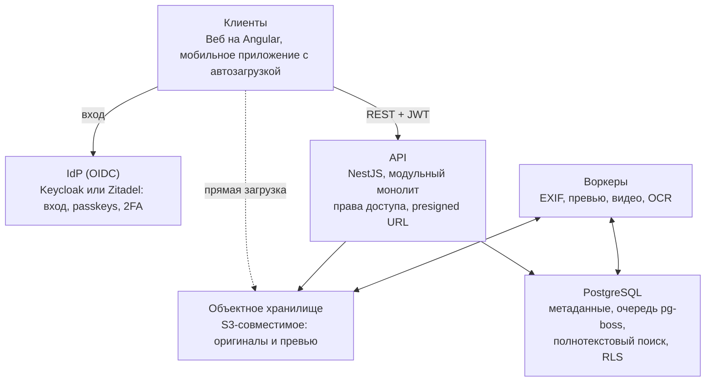

# Архитектура бэкенда семейного архива

19 ноября 2026 · Дмитрий · Исходный документ: https://claude.ai/artifact/MonpYe37uGccyXZ4yLmuuF

Рекомендация: модульный монолит на TypeScript, отдельные воркеры для тяжёлой обработки, PostgreSQL для метаданных и S3-совместимое хранилище для самих файлов. Первая версия — хранение фотографий и документов с доступом для всей семьи.

## Схема компонентов

Файлы идут мимо API: клиент грузит их прямо в хранилище.

Клиент входит через IdP, вызывает API и загружает файлы напрямую в хранилище. Воркеры берут задачи из очереди в PostgreSQL и пишут превью обратно в хранилище.

## 1. Общая форма: модульный монолит и воркеры

Один репозиторий и один процесс API (NestJS или Fastify на TS), внутри чёткие модули: `identity` (семьи, участники, роли), `assets` (файлы), `albums`, `documents`, `sharing`, `search`, `jobs`.

У каждого модуля свои таблицы, и они обращаются друг к другу только через сервисный интерфейс, а не через чужие таблицы. Тот же код запускается вторым процессом в режиме воркера. Если когда-нибудь понадобится вынести модуль в отдельный сервис, границы уже будут готовы.

## 2. Хранение: байты отдельно, метаданные отдельно

- **Файлы лежат только в S3-совместимом хранилище**, никогда не в БД и не на локальном диске по захардкоженному пути. Сделайте интерфейс `BlobStorage`. В dev за ним стоит MinIO или Garage, в проде любое S3-совместимое хранилище (Hetzner, Backblaze B2, Cloudflare R2), а локальная ФС подойдёт для тестов.
- **Ключи не зависят от имени файла:** `families/{familyId}/assets/{assetId}/original` и рядом `.../thumb_256.webp`, `.../preview_1440.webp`, `.../video_720.mp4`. Оригинальное имя хранится только в метаданных.
- **Оригиналы неизменяемы.** Поворот, кроп и правка даты делаются как метаданные поверх оригинала. Производные файлы (превью и т.п.) можно в любой момент пересоздать.
- **SHA-256 каждого оригинала** даёт дедупликацию (уникальность `(family_id, sha256)`), проверку целостности и быструю синхронизацию с мобильных устройств.

## 3. Загрузка

Файлы идут от клиента прямо в хранилище по presigned URL, API только регистрирует и финализирует загрузку.

1. Клиент сообщает API: «хочу загрузить файл, вот размер, mime и sha256».
2. API отвечает: «такой файл уже есть» (дедуп) или выдаёт presigned URL. Для больших видео это multipart upload, альтернатива — протокол tus для докачки.
3. Клиент загружает файл **напрямую в хранилище**, так что API не прокачивает через себя гигабайты.
4. Клиент вызывает `complete`. API проверяет объект, переводит asset в статус `processing` и ставит задачи в очередь.

Мобильную автозагрузку закладывайте сразу. Нужен эндпоинт «вот пачка хэшей, каких у тебя нет?» и эндпоинт синхронизации изменений «всё, что поменялось после курсора X».

## 4. Обработка в воркерах

- **Очередь на первом этапе** — pg-boss или Graphile Worker прямо в PostgreSQL: на один компонент меньше, задачи ставятся в той же транзакции, что и запись asset. На BullMQ с Redis можно перейти позже, если упрётесь в производительность.
- **Пайплайн:** EXIF и метаданные (exiftool), превью (sharp/libvips), конвертация HEIC, видео (ffmpeg), для документов OCR (ocrmypdf/tesseract) и превью первой страницы PDF.
- **Задачи идемпотентные**: повторный запуск ничего не ломает, а при сбое состояние видно по статусу asset.
- ML (лица, семантический поиск по CLIP) потом можно вынести в отдельный Python-сервис, который берёт задачи из той же очереди.

## 5. Модель данных (ядро)

Все таблицы с данными семьи, кроме `user`, несут `family_id`. Для идентификаторов — UUIDv7.

| Таблица | Ключевые поля | Зачем |
| --- | --- | --- |
| `family`, `user`, `membership` | `family_id`, `user_id`, `role` | Роли owner / admin / member / viewer |
| `person` | имя, связь с `user` (необязательна) | Член семьи, не обязательно пользователь (бабушка, прадед, ребёнок); пригодится и для будущего древа |
| `asset` | `owner_id`, `kind` (photo / video / document), `mime`, `size`, `sha256`, `taken_at`, `status`, `visibility` (private / family), `deleted_at` | Общая таблица для всех файлов |
| `asset_derivative` | тип, ключ в хранилище, размеры | Превью и транскоды |
| `photo_meta` | камера, GPS, ориентация | Метаданные фото |
| `document_meta` | тип документа, номер, кем выдан, срок действия, извлечённый текст | Метаданные документов и поиск по OCR |
| `album`, `album_asset`, `tag`, `asset_tag`, `asset_person` | связи многие-ко-многим | Альбомы, теги, люди на фото и в документах |
| `share_link` | токен, срок действия, опционально пароль | Ссылки для тех, кто не в семье |

## 6. Доступ и безопасность

- **Аутентификацию не пишите сами.** Возьмите OIDC-провайдера (Keycloak, Zitadel, Authentik), он даст passkeys, 2FA и восстановление доступа. Бэкенд только проверяет JWT.
- **Авторизация** в сервисном слое, плюс `family_id` в каждой таблице и Row-Level Security в PostgreSQL как вторая линия защиты от ошибки в коде.
- **Файлы отдаются через короткоживущие presigned GET URL** или через API-прокси с поддержкой Range-запросов (для видео). Прямых публичных ссылок на бакет быть не должно.
- Корзина с soft delete и сроком хранения: в семейном архиве случайное удаление — самый вероятный способ потерять данные.

## 7. Что решить сразу (потом менять дорого)

1. **Сквозное шифрование (E2E) или нет.** Это главная развилка. С E2E сервер не может делать превью, OCR и поиск, всё уходит на клиент, и архитектура получается совсем другой. Совет: шифрование на стороне сервера (SSE) плюс зашифрованные бэкапы, а E2E позже только для отдельной категории «сейф» (паспорта и т.п.).
2. **Мультитенантность через `family_id`** с первого дня, даже если семья пока одна.
3. **UUIDv7** в качестве id: сортируются по времени и генерируются на клиенте для офлайн-загрузки.
4. **Время съёмки.** В EXIF часто нет часового пояса, поэтому храните локальное время и смещение отдельно, а не только `timestamptz`.
5. **Открытый формат экспорта**: оригиналы плюс JSON- или XMP-сайдкары с метаданными. Архив должен пережить само приложение.
6. **Бэкапы**: PostgreSQL через pgBackRest (WAL + full), бакет реплицировать в другое хранилище, и регулярно проверять восстановление.

## 8. Чего не делать на старте и итоговый стек

Не нужны на старте: микросервисы, Kubernetes, Elasticsearch (хватит полнотекстового поиска PostgreSQL и pg_trgm, позже pgvector), собственная аутентификация, GraphQL, ML. Всё это можно добавить позже, если архитектура выше соблюдена.

| Слой | Выбор |
| --- | --- |
| API и воркеры | NestJS + TypeScript |
| Доступ к БД | Kysely или Drizzle |
| База данных | PostgreSQL |
| Очередь | pg-boss |
| Файлы | S3-совместимое хранилище |
| Обработка | sharp, ffmpeg, exiftool, ocrmypdf |
| Аутентификация | Keycloak или Zitadel (OIDC) |
| Прокси и развёртывание | Caddy, Docker Compose |
| Клиент | Angular с типизированным клиентом, сгенерированным из OpenAPI |
